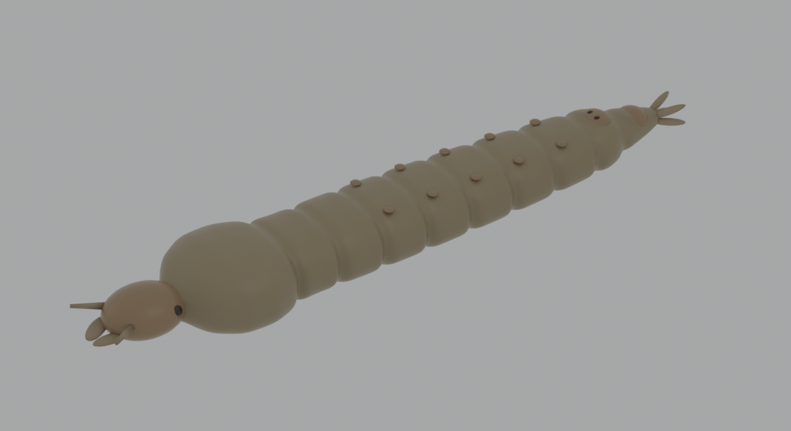

# Anopheles larva 3D model (4th instar)

A parametric 3D model of a fourth-instar *Anopheles* mosquito larva for 3D printing, teaching, and image simulation in Blender.



The model follows published morphological descriptions of fourth-instar *Anopheles* larvae. It is not a scan of a specimen, and it is not specific to any species.

Real-size total length is about 6.1 mm (antennae to anal papillae). Maximum width is about 1.2 mm at the thorax. The larva rests parallel to the water surface with no siphon, as in living *Anopheles* larvae.

## Included structures

Head capsule, compound eyes, antennae, lateral palatal (mouth) brushes, thorax, abdominal segments I–VIII and X, spiracular plate with paired spiracles on segment VIII, saddle on segment X, four anal papillae, and simplified palmate hairs on segments III–VII. Other setae are omitted.

## Files

| Path | Content |
|---|---|
| `models/stl/anopheles_larva_print_x10.stl` | 10x scale (about 61 x 12 x 7 mm) for FDM printing. Appendages thickened 2.5x; palmate hairs removed. |
| `models/stl/anopheles_larva_realsize_mm.stl` | Real size in millimetres, watertight. For simulation or high-resolution resin printing. |
| `models/anopheles_larva.obj` / `.mtl` | Mesh with per-part colours (no translucency). |
| `models/anopheles_larva.blend` | Blender 5.0 file with translucent materials and two bend modifiers for posing. |
| `scripts/anopheles_larva.py` | Parametric model script (Blender / bpy). |
| `scripts/run_with_bpy.py` | Runs the model script with the `bpy` Python module instead of the Blender app. |
| `scripts/make_three_view.py` | Makes the three-view drawing from the OBJ model. |
| `docs/anopheles_larva_three_view.pdf` | Orthographic three-view drawing with dimensions (third-angle projection, A3, 40:1). |
| `docs/images/` | Renders and a PNG of the three-view drawing. |

Coordinates are in millimetres. +X points posterior, +Z points dorsal.

## Regenerating the model

With Blender installed:

```
blender -b -P scripts/anopheles_larva.py -- --out ./out
blender -b -P scripts/anopheles_larva.py -- --out ./out --print
```

The first command writes the `.blend`, OBJ, real-size STL, and renders. The second writes the 10x printable STL.

Parameters are in the `PARAMS` dictionary at the top of `scripts/anopheles_larva.py`: abdominal segment length, depth of intersegmental grooves, cross-section shape, appendage thickness, and optional palmate and lateral setae.

## Posing in Blender

Open `models/anopheles_larva.blend` and select `Anopheles_larva_L4`. Change the angle of `Bend_lateral` to curve the body in the water-surface plane, or `Bend_dorsoventral` to curve it up or down.

## Three-view drawing

```
pip install -r requirements.txt
python scripts/make_three_view.py
```

The script needs the Noto Sans CJK JP font for the Japanese labels.

## Printing

Print the 10x file lying flat, ventral side down. Suggested settings: 0.12–0.16 mm layer height, 15–20% infill, tree supports under the head and anal papillae. Translucent amber or natural PLA gives a realistic look. These settings have not yet been test-printed.

## Possible uses

Dummy larvae for testing drone or camera-based larval detection, synthetic training images for object detection, field team training, and teaching.

## Limitations

Proportions are approximate. For quantitative work, check dimensions against your own specimens and adjust the parameters.

## Citation

If you use this model, please cite it using the metadata in `CITATION.cff` (GitHub shows a "Cite this repository" button).

## Licence

- Code (`scripts/`): MIT License, see `LICENSE`.
- 3D models, drawings, and images (`models/`, `docs/`): CC BY 4.0, see `LICENSE-models.md`.

## Acknowledgement

Morphological terminology follows published identification keys for fourth-instar *Anopheles* larvae, including:
Identification keys to the *Anopheles* mosquitoes of South America (Diptera: Culicidae). II. Fourth-instar larvae. *Parasites & Vectors* 13, 582 (2020). https://doi.org/10.1186/s13071-020-04299-5

The model and scripts were developed with assistance from Claude (Anthropic).
